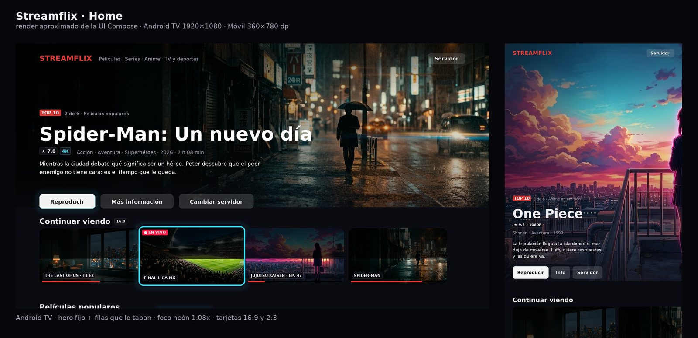

<h1 align="center">Streamflix Reborn</h1>

<p align="center">
  
  <br />
  <strong>🔄 Reborn Version</strong> - Community continuation of the original Streamflix project
  <br />
  An open-source Android TV and mobile app for educational streaming interface, made with Android Studio, in Kotlin
  <br />
  <a href="https://github.com/streamflix-reborn/streamflix/releases/latest">
    <strong>Download app »</strong>
  </a>
  <br />
  <br />
  <a href="https://github.com/streamflix-reborn/streamflix/issues">Report Bug</a>
  ·
  <a href="https://github.com/streamflix-reborn/streamflix/issues">Request Feature</a>
</p>

<details>
  <summary>Table of Contents</summary>

- [About the project](#about-the-project)
  - [What is Streamflix Reborn?](#-what-is-streamflix-reborn)
  - [Features](#features)
  - [Built with](#built-with)
- [Getting started](#getting-started)
  - [Prerequisites](#prerequisites)
  - [Setup](#setup)
- [Autonomous Android mode](docs/autonomous-android.md)
- [Stremio addon backend (Node.js)](#stremio-addon-backend-nodejs)
- [Android client (Kotlin + Compose)](#android-client-kotlin--compose)
- [Development](#development)
- [Contributing](#contributing)
- [Legal Disclaimer](#legal-disclaimer)
- [Credits & Authors](#credits--authors)
- [License](#license)
</details>

## About the project

<p align="center">
  
</p>

**Streamflix Reborn** is an independent continuation of the original Streamflix project created by [Lory-Stan TANASI](https://github.com/stantanasi). This reborn version maintains the same educational purpose and functionality while ensuring continued development and support.

### 🔄 What is Streamflix Reborn?

- **Independent Continuation**: This is an independent continuation of the original Streamflix project
- **Same Vision**: Maintains the original educational and open-source philosophy
- **Enhanced Support**: Continued development and bug fixes by an independent developer
- **Respectful Fork**: Built with full respect for the original creator's work

Streamflix Reborn is an open-source Android TV and mobile app that provides a user interface for accessing publicly available streaming content from various third-party providers.

This app is designed for educational purposes and personal use only. Users are responsible for ensuring they have proper authorization to access any content they view through this application.

The interface aggregates content from multiple sources and provides a convenient way to browse available streaming options.

### Features

- **Autonomous by default:** Python 3.11 and the twelve real provider scrapers run inside the APK; no Node.js server, IP address or backend deployment required
- Direct provider catalogues, local episode discovery and on-device cache; optional Cinemeta catalogues
- Optional external-server mode remains available in Settings
- Open-source and ad-free interface
- Aggregates content from multiple third-party providers
- No account required for the app interface
- Educational and personal use only
- One APK with an adaptive UI: D-Pad-first on Android TV, touch-first on phones
- Multiple providers, with automatic silent failover between their streams
- Home with horizontal carousels for Películas, Series, Anime and TV en Vivo

### Built with

- [Android Studio](https://developer.android.com/studio)
- [Kotlin](https://kotlinlang.org) + Coroutines
- [Jetpack Compose](https://developer.android.com/jetpack/compose) + Material 3
- [Media3 ExoPlayer](https://developer.android.com/media/media3/exoplayer)
- [OkHttp](https://square.github.io/okhttp) + kotlinx.serialization
- MVVM architecture (`ViewModel` + `StateFlow`)
- One APK for phones and Android TV


## Stremio addon backend (Node.js)

`server/` is **optional for the Android app**. It contains a lightweight Node.js + Express backend that exposes this
catalogue to any Stremio-compatible client (including the Android TV app)
through the official Addon protocol:

- `GET /manifest.json` — declares `movie`, `series`, `anime`, `tv` and the
  published catalogs (`catalog` + `meta` resources).
- `GET /catalog/:type/:id.json` — Stremio catalog protocol, backed by
  **[Cinemeta](https://github.com/Stremio/stremio-addon-sdk)** (the official
  metadata addon), merged with the local live TV/sports rows and with the
  catalogs of a third-party Stremio addon:
  `top`, `year`, `imdbRating` for movies and series, `anime/top`
  (Cinemeta `series` + `genre=Animation`), `tv/live` from
  `server/config/live-catalog.json`, and **`streaming_<service>`** rows
  (Netflix, Disney+, Prime Video, HBO Max, Apple TV+…) republished from
  *Streaming Catalogs* — any other Stremio addon can be added the same way
  through the `addons` block (no code, no copying their data).
  Accepts the standard extras as path segments — `/catalog/movie/top/search=matrix.json`,
  `/catalog/tv/live/genre=Deportes/skip=20.json`.
- `GET /meta/:type/:id.json` — rich metadata (synopsis, poster, year, rating)
  and, for series, the episode list (`tt0944947:1:2`), so a Cinemeta poster
  becomes a playable request.
- `GET /stream/:type/:id.json` — returns `streams` ordered by provider
  priority so ExoPlayer can fail over (source 1 → 2 → 3).
- In-memory TTL cache (2 h live / 6 h VOD) with single-flight and
  stale-while-revalidate: a cached live `.m3u8` is served in a few milliseconds.
- Python scraper bridge (`child_process.spawn`) invoked only on cache misses.
- Twelve real providers ship in `server/scrapers/`, ordered by priority.

  **Live** (`kind: "live"`, requested as `tv:<id>`):

  - `futbolibre.py` — [futbolibre.live](https://futbolibre.live/) (priority 3):
    Mexican sports channels (`tv:futbolibre:espn-1`) plus the daily match agenda
    where every match yields several signals
    (`tv:futbolibre:evento:<slug>`);
  - `deportelibre.py` — [deportelibre.top](https://deportelibre.top/) (4):
    24/7 channel catalogue (`tv:deportelibre:stream-01`);
  - `tvenvivo.py` — [tvenvivo.org](https://www.tvenvivo.org/) (5): live
    TV/sports (`tv:tvenvivo:espn-2`).

  **Anime** (`kind: "vod"`, requested as `anime:<id>`):

  - `animeflv.py` — [animeflv.net](https://www3.animeflv.net/) (6):
    `animeflv:one-piece:1180`;
  - `jkanime.py` — [jkanime.net](https://jkanime.net/) (7):
    `jkanime:one-piece:1180`;
  - `monoschinos.py` — [monoschinos.st](https://monoschinos.st/) (8):
    `monoschinos:one-piece-sub-espanol:1`.

  **Movies & series** (`kind: "vod"`, requested as `movie:<id>` or
  `series:<id>:<season>:<episode>`):

  - `gnula.py` — [gnulahd.nu](https://ww3.gnulahd.nu/) (11):
    `gnula:street-fighter` (decodes the site's `GNRD` player API);
  - `cuevana.py` — [cuevana3.nu](https://cue.cuevana3.nu/) (12):
    `cuevana:spider-man-de-regreso-a-casa` (`showEmbed` base64 payloads);
  - `pelisplushd.py` — [pelisplushd.la](https://www.pelisplushd.la/) (13):
    `pelisplushd:the-last-of-us:1:2`;
  - `repelis.py` — Repelis (14): `repelis:<slug>`, domain set with
    `REPELIS_BASE` / `REPELIS_MIRRORS`;
  - `peliculasflix.py` — [peliculasflix.co](https://peliculasflix.co/) (15):
    `peliculasflix:<slug>` (own GraphQL API);
  - `pelisjuanita.py` — [pelisjuanita.org](https://pelisjuanita.org/) (16):
    `pelisjuanita:spider-man-un-nuevo-dia-2026`;

  The anime and movie providers return **one stream per resolved server**
  (Streamwish, VOE, Filemoon, Streamtape…), in the site's order, so the
  ExoPlayer failover also covers a dead file host. Movie ids accept a site slug,
  `season:episode`, an IMDb id (`gnula:tt0145487`, with `TMDB_API_KEY`) or free
  text that gets searched on the site.

```bash
cd server
npm install
npm start
# manifest → http://localhost:7000/manifest.json
# catalog rows → http://localhost:7000/catalog/tv/live.json
#               http://localhost:7000/catalog/movie/top.json
# search →      http://localhost:7000/catalog/movie/top/search=matrix.json
# metadata →    http://localhost:7000/meta/series/tt0944947.json
# live channel → http://localhost:7000/stream/tv/tv:futbolibre:espn-1.json
# anime episode → http://localhost:7000/stream/anime/animeflv:one-piece:1180.json
npm run channels:futbolibre   # list channels + matches with ready-to-use ids
npm run channels:deportelibre
npm run channels:tvenvivo
npm run anime:animeflv        # list episodes + ids (also jkanime, monoschinos)
npm run movies:gnula -- "street fighter"   # search + ids (also cuevana, pelisplushd…)
```

These scrapers only read public pages: nothing is hosted or redistributed here.
Use them with authorization and in line with each site's terms and your local
law.

See [`server/README.md`](server/README.md) for the full documentation
(architecture, environment variables, cache internals, adding providers,
tests and Docker).

## Android client (Kotlin + Compose)

`app/` now includes the scrapers from `server/scrapers/` and an embedded Python
runtime (Chaquopy). The default path is Compose → local engine → provider →
Media3, all on the device. It does not start Node, a shell or an HTTP server.
The existing addon remains available only when explicitly selected in Settings.
See [Autonomous Android mode](docs/autonomous-android.md) for architecture,
requirements, offline tests and limitations.

| Concern | Choice |
| --- | --- |
| UI | Jetpack Compose, Material 3 (Compose BOM `2025.06.00`) |
| Player | Media3 ExoPlayer `1.7.1` + `media3-exoplayer-hls` |
| HTTP | OkHttp `4.12.0` + kotlinx.serialization |
| Posters | Coil |
| DI | hand-written `ServiceLocator` (no annotation processor) |
| Embedded scraping | Chaquopy `17.1.0`, Python `3.11`, standard library only |
| SDK | `minSdk 24`, `targetSdk 35`, `compileSdk 36`, JVM 17 |

### Visual design

Three references, each doing one job:

| Reference | What is borrowed |
| --- | --- |
| **Apple TV+** | a cinematic hero whose backdrop follows the focus, with a slow Ken Burns drift and three actions (Reproducir / Más información / Cambiar servidor) |
| **Netflix** | fluid horizontal carousels, 2:3 poster cards, focus scale 1.08x and a floating "Continuar viendo" row |
| **Prime Video** | floating state badges on the artwork (EN VIVO, quality, provider) and a quick-look details panel before playback |

Everything is Compose (no XML layouts): `ui/home/HeroBanner.kt`,
`ui/components/MediaCards.kt`, `ui/components/MediaRow.kt`,
`ui/components/Badges.kt`, `ui/details/DetailsPanel.kt`.



*(Static render of the same colours, sizes and artwork the Compose code uses —
useful as a reference while the APK cannot be built in this environment.)*

**Hero geometry (TV).** Two different numbers: the backdrop box is 0.78 of the
screen height, but the text block is anchored at a 0.62 baseline, and that is
exactly where the first shelf starts. That leaves the CTAs clear, one full 16:9
row visible and the next row's title peeking — the visual cue to press DOWN.
On phones the hero is simply the first cell of the list (0.62 of the screen).

**Hero.** `HomeCatalog` + `HomeViewModel` keep a `Spotlight`: the card currently
focused (TV) or the featured title (phone). Focusing a card swaps the backdrop
with a 420 ms crossfade, so the hero reads like it is following intent rather
than looping slides. The backdrop is one of four 1280×720 stills shipped in
`res/drawable-nodpi` (`art_movies`, `art_series`, `art_anime`, `art_live`), used
when a title has no 16:9 artwork of its own — which is the normal case for
provider catalogues (they publish 2:3 posters only).

**Cards.** One shared `ContentCard` skeleton renders both proportions, and the
row decides which one it wants (`aspect: "poster" | "landscape"` in the
catalogue JSON):

| Row | Aspect | Content |
| --- | --- | --- |
| Continuar viendo | 16:9 | progress bar under the artwork |
| Películas populares | 2:3 | poster |
| Series que enganchan | 2:3 | poster |
| Anime en emisión | 2:3 | poster |
| Deportes en directo | 16:9 | live channel tile |

Focus in TV = scale 1.08 + elevation + the neon ring (`Modifier.tvFocusGlow`,
cyan on purpose: red is already "live/brand"). The title under a card fades in
with the focus, so an unfocused shelf stays clean.

**Badges.** `LiveBadge` (pulsing dot), `TrendingBadge` (TOP 10),
`QualityBadge` (4K in neon), provider chip at the bottom and a progress bar for
resumed titles. During playback the player shows `FailoverBadge` with the source
actually on screen ("Fuente 2 de 5"), which is where that number is truthful.

**Details before playback.** Tapping a card opens `DetailsDialog`, a `Dialog`
(its own window, so the D-Pad cannot escape to the shelf behind): backdrop
header with rating/quality/genres, synopsis, and the **server selector** — the
list of sources the addon returned, in its priority order, already loaded
through `StreamsRepository`. The chosen index travels to the player as
`PlaybackRequest.startIndex`, and the silent failover continues downward from
there. "Cambiar servidor" in the hero opens this same panel with the focus
already on the list.

### One APK, two form factors

`core/DeviceProfile.kt` decides once (in `Application.onCreate`) whether the app
is running on a TV:

```text
UI_MODE_TYPE_TELEVISION               -> TV
FEATURE_LEANBACK or FEATURE_TELEVISION and no touchscreen -> TV
otherwise                             -> touch
```

The result is published through `LocalDeviceProfile`, so every composable reads
it without touching the `Context`:

- **TV** — larger cards (196×292 dp), 48 dp side margins, typography scaled
  ×1.15–1.25, and every card draws a red focus ring plus an 8 % scale-up when
  the D-Pad lands on it. The first card of the top row grabs focus on purpose:
  without it a remote does nothing until the user guesses to press a key. The
  player overlay chips (Fuentes / Volver) get the same treatment.
- **Touch** — compact cards (128×192 dp), 16 dp margins, ripple instead of a
  focus ring.

`AndroidManifest.xml` declares `android.software.leanback` and
`android.hardware.touchscreen` as `required="false"` and registers both
`LAUNCHER` and `LEANBACK_LAUNCHER`, so the same APK shows up on a phone and in
the Android TV home row.

### Player and automatic failover

`player/` holds the whole policy, and it is plain Kotlin (no Android imports)
except for `MediaSources`, which is the only place that knows about Media3:

1. `StreamsRepository` normalises the addon response: drops unplayable URLs and
   duplicates, keeps the server's priority order **untouched**.
2. `FailoverPlanner` walks that list: index 0 is the best source, each source is
   tried once, and the list never wraps around (no infinite loops).
3. `FailoverController` reacts to `onPlayerError` and to silent stalls (a
   12 s watchdog while buffering with `playWhenReady` — a user pause never
   triggers a hop), and swaps the `MediaSource` on the **same** `ExoPlayer`
   instance, resuming at the last known position. No black flash, no dialog, no
   relaunch: at most a brief "Cambiando de servidor…" chip.
4. DRM errors are the one exception: another CDN cannot fix a license, so the
   user is told instead of being bounced around (`FailoverRules`).

### Player controls (D-Pad first)

The player doesn't use Media3's built-in controller (`useController = false`);
`ui/player/PlayerControls.kt` draws its own, because the stock one documents no
behaviour for the direction keys and can't share the app's focus language.

| Key | Action |
| --- | --- |
| `OK` / `ENTER` / `SPACE` / gamepad `A` | play / pause |
| `◀` / `▶` (and `MEDIA_REWIND` / `MEDIA_FAST_FORWARD`) | −10 s / +10 s (VOD only) |
| `▼` / `▲` | show the controls and move the focus into them |
| `BACK` | hide the controls; a second press leaves the player |
| tap (phone) | show / hide the controls |

Details that matter on a sofa:

- everything fades out after **4 s** while playing, and only while the focus is
  still on the video surface — if you are walking the buttons they stay put;
- while the controls are hidden, `OK` pauses and the arrows seek **without**
  bringing the UI back, so the failover and normal playback stay unobtrusive;
- `LEFT`/`RIGHT` never steal the event when a button is focused: there they move
  the focus between buttons, as expected;
- the seek arithmetic lives in `player/SeekPolicy.kt` (clamped to `0..duration`,
  unknown duration = no upper bound) and is unit-tested;
- live channels hide the seek buttons and the progress bar: an HLS live window
  has no duration to show, and seeking it only triggers a rebuffer.

The red ring + halo is `Modifier.tvFocusGlow` (`ui/theme/Focus.kt`), the Compose
equivalent of the classic pair of XML state drawables:

```text
res/color/card_focus.xml + android:focusable="true"   →  Modifier.tvFocusGlow(progress)
```

Both the home cards and the player buttons use it, so the focus style is
identical in the catalogue and on top of the video.

### Per-source HTTP headers

Streamwish, Filemoon, VOE and friends reject a `.m3u8` without the `Referer` of
the page that published it. The addon already ships those headers in
`behaviorHints.requestHeaders`; `MediaSources.dataSourceFactory()` copies them
into a `DefaultHttpDataSource.Factory` (adding a derived `Origin` and allowing
cross-protocol redirects), and each source gets its own factory, since the
`Referer` changes hop by hop.

### Autonomous mode and optional server

**Ajustes → Autónomo · En este dispositivo** is the default, including after an
upgrade from the old server-only build. First launch does not ask for a URL.
Catalogues are queried directly from the bundled providers. Cinemeta rows are
an explicit opt-in, not a requirement for browsing provider catalogues.

An external server can still be selected in **Ajustes → Servidor externo**.
Only that mode uses `DEFAULT_ADDON_BASE_URL` / the saved URL. Returning to local
mode never silently contacts that backend as a fallback.

Internet and the original content hosts are still required. Autonomous does
**not** mean offline video, bundled films or independence from the source sites.
A changed domain, anti-bot challenge or dead video host can still break a source.

### Home catalogue

- The twelve provider definitions and curated live-channel IDs are packaged
  from `server/config/`; the demo Python providers and server-only third-party
  addon configuration are excluded.
- Native Python calls scrape the provider home/search pages for movies, series,
  anime, live channels and sports. Posters and episode lists come from those
  same pages where available. No private TMDB key is required.
- The saved live-channel shelf is available immediately without a metadata
  service. Other shelves appear incrementally as providers answer.
- **Buscar** queries the providers; **Inicio** clears the search.
- Catalogue metadata is cached on disk for one hour (live: ten minutes), with
  a bounded stale fallback for titles/artwork. Signed stream URLs have a short
  cache only and are never served stale after its expiry.
- The details sheet discovers numbered episodes; if no list is published,
  series/anime offer explicit manual season/episode selection rather than
  inventing a list or playing episode one silently.
- Per-source Referer, User-Agent, Origin and Cookie headers survive into Media3.
  Both HLS and DASH modules are included.

In optional server mode, the original `/catalogs.json`, `/catalog`, `/meta` and
`/stream` protocol and server configuration continue to work.

### Build, run, test

Requirements: JDK 17, Android SDK 36, **Python 3.11 on the build machine**.
The TV/phone needs **Android 7.0 / API 24+**. The universal APK supports
`armeabi-v7a`, `arm64-v8a` and `x86_64`; there is no device-side Python install.

```bash
# No npm start, ADDON_BASE_URL or server setup required:
./gradlew :app:assembleDebug
./gradlew :app:testDebugUnitTest :app:lintDebug
python3 scripts/verify-embedded-apk.py app/build/outputs/apk/debug/app-debug.apk

# Offline tests of the actual engine + existing Python scrapers:
python3 -m unittest discover -s app/src/test/python -v

# Device/emulator smoke test: native Python + all twelve imports, no backend:
./gradlew :app:connectedDebugAndroidTest

# Optional backend regressions (separate from the Android runtime):
(cd server && npm ci && npm test)
```

`AutonomousContentTest` covers URL-free repository calls, mode selection, no
implicit remote fallback, complete playback headers, search/episode IDs and
cancellation. Existing player, repository and addon tests remain in place.
`EmbeddedEngineSmokeTest` executes the bundled Python runtime on Android.
`verify-embedded-apk.py` checks the actual APK's script archive and native
libraries; a small file size is never used as proof of completeness.

### Release build (APK + AAB)

One signed artifact installs on both a phone and an Android TV box (see
[One APK, two form factors](#one-apk-two-form-factors)).

```bash
./scripts/release-android.sh       # autonomous APK + AAB + package verification
```

The script is a thin wrapper; the same build by hand is:

```bash
./gradlew :app:assembleRelease :app:bundleRelease
```

Outputs:

| Artifact | Path |
| --- | --- |
| APK (sideload to TV/phone) | `app/build/outputs/apk/release/app-release.apk` |
| AAB (Google Play) | `app/build/outputs/bundle/release/app-release.aab` |
| R8 mapping (crash de-obfuscation) | `app/build/outputs/mapping/release/mapping.txt` |

Without a keystore the APK is written as `app-release-unsigned.apk`: **it will
not install** until it is signed. That is deliberate — silently signing with the
debug key produces an app that cannot be updated later.

#### Optional backend URL

No URL is required to build debug or release. If supplied, the default for the
optional server mode is resolved from `ADDON_BASE_URL`,
`-PreleaseAddonBaseUrl=…`, or `releaseAddonBaseUrl` in `keystore.properties`.
It does not change the default autonomous mode. The old
`allowEmptyAddonBaseUrl` escape hatch is no longer necessary.

#### Signing

```bash
keytool -genkeypair -v -keystore release.keystore -alias streamflix \
    -keyalg RSA -keysize 4096 -validity 10000
cp keystore.properties.example keystore.properties   # then fill it in
```

`keystore.properties` and every `*.keystore` / `*.jks` are git-ignored. The four
values can also come from the environment (`RELEASE_STORE_FILE`,
`RELEASE_STORE_PASSWORD`, `RELEASE_KEY_ALIAS`, `RELEASE_KEY_PASSWORD`), which is
how `.github/workflows/android-release.yml` signs in CI (keystore base64 in a
secret). Signing enables v1 + v2 + v3, so the same APK installs on old Android TV
boxes and on current phones.

#### What the release build changes

- **R8 full mode**: obfuscation + tree shaking + resource shrinking
  (`android.enableR8.fullMode=true`). `proguard-rules.pro` keeps only what is
  resolved by name (manifest components, `kotlinx.serialization` metadata and
  `$$serializer`s) plus `-assumenosideeffects` on `Log.v/d/i`, so debug logging
  from Kotlin is removed. Python diagnostics retain the scrapers' existing
  behaviour. No blanket
  `-keep class androidx.**`.
- **Embedded runtime and real scrapers**: the Python code and native libraries
  are packaged with the application. Demo/template providers are excluded.
  Chaquopy supplies its own JNI/reflection R8 consumer rules.
- **No tooling**: Compose preview/tooling is `debugImplementation`; `DEBUG_BUILD`
  is `false` and `AppLog.d/i` are stripped.
- **Smaller, faster**: `shrinkResources`, `resConfigs` not needed (single
  locale), packaging excludes, and `versionCode`/`versionName` overridable with
  `-PVERSION_CODE=…  -PVERSION_NAME=…` for store uploads.

#### Install and verify

```bash
adb install -r app/build/outputs/apk/release/app-release.apk
adb shell pm list packages | grep tanasi      # com.tanasi.streamflix
```

On a TV: `adb connect <box-ip>:5555` first, then the same `install`. The leanback
launcher entry and the TV banner come from the manifest, and `uses-feature
leanback/touchscreen` are both `required="false"`, so a single APK is offered to
phones and TVs alike (API 24+). Smoke test: leave every Node backend stopped,
install the APK, open the Home without entering a URL, browse/search a provider,
choose an episode and play an authorized source. Disconnecting Internet must
still report unavailable playback; the saved cards are not offline videos.

#### CI

`.github/workflows/android-release.yml` builds the same artifacts on a runner
with JDK 17 + Python 3.11 + Android SDK, runs the offline engine tests,
Kotlin tests and `lintRelease`, verifies the signature with `apksigner` and
checks the embedded Python payload before uploading APK, AAB and R8 mapping.
`autonomous-checks.yml` additionally builds the debug APK, runs the Android TV
emulator smoke test and checks the existing backend for regressions.

- **manual**: *Run workflow* with the backend URL empty for a fully local engine;
  a supplied URL is only a default for the optional server mode;
- **tag**: pushing `v1.0.0` uses the `PRODUCTION_ADDON_BASE_URL` repository
  variable.

Signing: if the `RELEASE_KEYSTORE_BASE64`, `RELEASE_STORE_PASSWORD`,
`RELEASE_KEY_ALIAS` and `RELEASE_KEY_PASSWORD` secrets exist, that keystore is
used. Otherwise the workflow generates a **sideload** key, signs with it, and
publishes it as the `sideload-keystore` artifact — download it and keep it, or
the next build will not install over this one (Android requires the same
signature). That key is not valid for Google Play.

## Getting started

### Prerequisites

Install [Android Studio](https://developer.android.com/studio)

### Setup

1. Clone the project to your local machine

```bash
git clone https://github.com/streamflix-reborn/streamflix.git
```

2. Open the project in Android Studio

## Development

1. Select the device that you want to run the app

2. Click **Run**

## Contributing

Contributions are what make the open source community such an amazing place to learn, inspire, and create. Any contributions you make are **greatly appreciated**.

1. Fork the project
2. Create your feature branch (`git checkout -b feature/amazing-feature`)
3. Commit your changes (`git commit -m 'feat: add some amazing feature'`)
4. Push to the branch (`git push origin feature/amazing-feature`)
5. Open a pull request

## Legal Disclaimer

**IMPORTANT: This application is for educational and personal use only.**

- Streamflix does not host, store, or distribute any copyrighted content
- All content is sourced from third-party providers and websites
- Users are solely responsible for ensuring they have legal rights to access any content
- The developers do not endorse or encourage copyright infringement
- Users must comply with all applicable laws in their jurisdiction
- Any legal issues should be directed to the actual content providers
- This app functions as a search engine aggregator only
- No copyrighted material is stored on our servers

## Legal Notice

This application is provided "as is" for educational purposes. The developers:
- Do not claim ownership of any content
- Do not profit from copyrighted material
- Do not control third-party content providers
- Encourage users to support content creators through legal means
- Recommend using official streaming services when available

## Credits & Authors

### Original Creator
- **[Lory-Stan TANASI](https://github.com/stantanasi)** - Original Streamflix project creator

### Reborn Development
- **Independent Developer** - Streamflix Reborn maintainer
- **Special thanks** to the original creator for the excellent foundation

## License

This project is licensed under the `Apache-2.0` License - see the [LICENSE](LICENSE) file for details

### Original Project
<p align="center">
  <br />
  © 2022 Lory-Stan TANASI. All rights reserved
</p>

### Reborn Project
<p align="center">
  <br />
  © 2025 Streamflix Reborn. Built with respect for the original work.
</p>